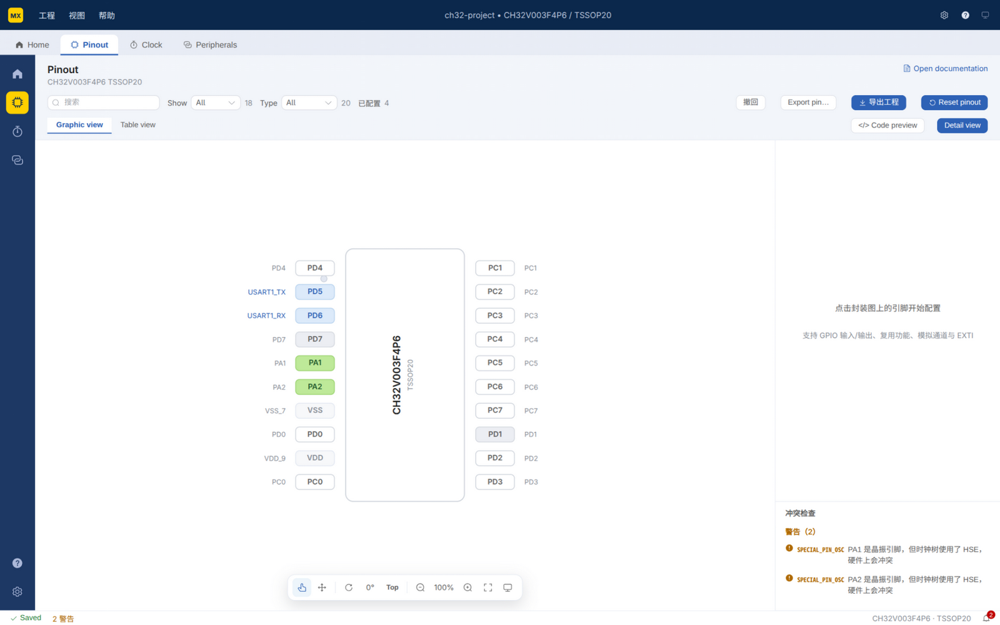
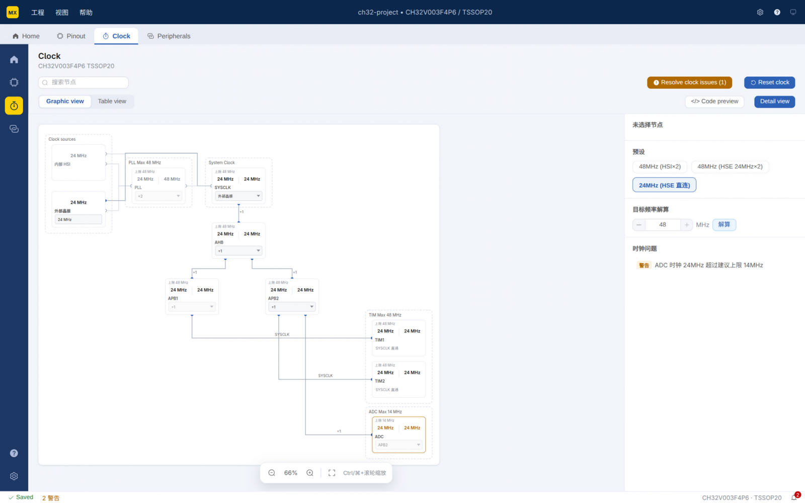

# ch32-rs-CubeMX

> 纯本地 CH32 RISC-V 图形化配置器：在封装图上点引脚、配置外设与时钟树，生成**可直接 `cargo build` 的 Rust 工程**（[ch32-hal](https://github.com/ch32-rs/ch32-hal) / [ch5xx-hal](https://github.com/ch32-rs/ch5xx-hal) / [ch58x-hal](https://github.com/ch32-rs/ch58x-hal) legacy）。界面交互对标 STM32CubeMX2，代码生成后端是 Rust，不生成 C 代码。

[](LICENSE)
[](https://github.com/3808000/ch32-rs-cubemx/releases)

提供两种形态：

- **桌面应用**（Tauri 2，推荐）：从 [Releases](https://github.com/3808000/ch32-rs-cubemx/releases) 下载对应平台安装包。
- **浏览器模式**：`npm run dev` 本地运行，或 `npm run build` 后部署 `dist/`。

## 特性

- **封装图点引脚**：GPIO、复用功能（AF/remap）、模拟、EXTI、保留引脚统一在封装图上分配；九态过滤、图例、右键菜单、信号选择器、拖拽移脚、90° 旋转与 Bottom 镜像、分组与冲突检查。
- **外设配置**：USART / SPI / I2C / ADC / EXTI 实例配置，含 remap 档位、Mode + Activate 流程与参数编辑；时钟树覆盖 AHB/APB、TIM、USB、ADC 等时钟域（USB 48M 域为仅显示）。
- **MX2 风格时钟树**：逐芯片按 RM/DS 时钟框图转录并手写布局（7 份转录，含版本/图号/页码/SHA-256）；输入源左列、主干水平，输出与外设**上下并联竖排**；PLL 求解器、预设匹配、锁定节点、冲突检查与 `Resolve issues` 自动修复；无驱动/未建模域以灰显**仅显示**补全（LSI/LSE/RTC/MCO/PLL2/3/USBHS/32K、CORE/SYSTICK 等），不进入配置与代码生成。
- **BLE 配置（CH582M）**：数据驱动的 peripheral（含简单 GATT 服务）/ broadcaster / observer 三角色，广播名、间隔、MAC、UUID16、notify 等参数；legacy ch58x-hal 路径的广播、连接建立与手机侧 GATT 读写已实机验证；ch5xx-hal 路径（`ch5xx-ble` shim）亦已实机验证通过（连接 → GATT 读写 → notify 1s 周期，2026-11-19 复验 ×2；见 [HAL_API_NOTES §17](docs/HAL_API_NOTES.md)）。
- **中断与 DMA 视图**：NVIC/PFIC 中断使能与优先级，生成 `generated/irq.rs`；DMA 通道配置用于 embassy 档。
- **代码生成**：`src/generated/**` 每次导出整体重写，`src/main.rs` 永不覆盖；导出工程内嵌完整 vendor HAL 并以 path 依赖引用；H417 生成双核 Cargo workspace；导出前有冲突预览与逐文件决议，保留用户手改内容。
- **工程回读与管理**：`cube.json` 导入/导出可往返编辑；桌面端磁盘工程库、自动保存、最近工程、全局撤销/重做、Monaco 只读预览与 diff、HTML 单文件报告、可选 VS Code 配置。
- **纯本地**：无云端依赖、无账号、无遥测；浏览器模式同样在本地完成生成与打包。

## 支持芯片

| 芯片 | 封装 | 内核 | 目标 / 工具链 | 生成支持 |
|---|---|---|---|---|
| CH32V003F4P6 | TSSOP20 | QingKe V2A（RV32EC） | `riscv32ec-unknown-none-elf` · nightly | ✅ ch32-hal（blocking / embassy） |
| CH32V103C8T6 | LQFP48 | QingKe V3A（RV32IMAC） | `riscv32imc-unknown-none-elf` · stable | ✅ ch32-hal（blocking / embassy） |
| CH32V203C8T6 | LQFP48 | QingKe V4B（RV32IMAC） | `riscv32imac-unknown-none-elf` · stable | ✅ ch32-hal（blocking / embassy） |
| CH32V307VCT6 | LQFP100 | QingKe V4F（RV32IMAFC） | `riscv32imfc-unknown-none-elf`（自定义 target，build-std）· nightly | ✅ ch32-hal（blocking / embassy） |
| CH32X035C8T6 | LQFP48 | QingKe V4C（RV32IMAC） | `riscv32imc-unknown-none-elf` · stable | ✅ ch32-hal（blocking / embassy） |
| CH32H417QEU6 | QFN128 | QingKe V3F + V5F 双核 | `riscv32imafc` / `riscv32imafbc` · stable | ✅ ch32-hal（双核 workspace，`cargo xtask build`；embassy 档暂不开放——双核异步路径待端到端验证） |
| CH582M | QFN48 | QingKe V4A（RV32IMAC） | `riscv32imc-unknown-none-elf` · nightly（build-std） | ✅ ch5xx-hal（blocking / embassy）+ `ch5xx-ble` shim（BLE，实机复验中）；legacy ch58x-hal opt-in（blocking / embassy / BLE） |

说明：CH582M 编译目标刻意选用 `riscv32imc`，以规避其 QingKe 原子指令缺陷（上游认可的回退路径），不属于数据错误。芯片差异由 `data/devices/<chip>/` 下的 JSON 数据表达，新增同族芯片以数据接入为主。

说明（M17）：CH582M 默认 HAL 后端为 ch5xx-hal（`875651b6`），BLE 由本仓库自带的 `ch5xx-ble` shim 提供（上游 ch5xx-hal 的 BLE 尚未实现）；可在 Project settings 切回 legacy ch58x-hal。ch5xx-hal 生成工程**仅支持内嵌 vendor 模式**：其 `build.rs` 读取兄弟目录 `../ch5xx-data/data`，因此导出包同时包含 `vendor/ch5xx-hal` 与 `vendor/ch5xx-data`（BLE 档另含 `vendor/ch5xx-ble`），纯 git rev 依赖会直接 panic。ch5xx 三档使用 nightly + `build-std=["core"]`（需要 `rust-src`），legacy 两档仍为 stable。

## 截图

| 引脚配置 | 时钟树 | 外设 |
|---|---|---|
|  |  |  |

## 下载桌面版 v0.1.0

前往 [Releases](https://github.com/3808000/ch32-rs-cubemx/releases) 页面下载。桌面产物由 GitHub Actions 在推送 tag 时自动构建并发布（工作流 `.github/workflows/release.yml`）。

| 平台 | 产物 | 说明 |
|---|---|---|
| Linux x86_64 | `.deb` / `.rpm` / `.AppImage` / 便携 `.tar.gz` | 便携包解压后运行 `./ch32-rs-cubemx`；需要系统 WebKitGTK 4.1 与 GTK3 运行库 |
| Windows x86_64 | `.msi` / `.exe`（NSIS） | 未签名安装包可能触发 SmartScreen，选择「更多信息 → 仍要运行」 |
| macOS universal | `.dmg` | 未签名/未公证：首次打开请右键「打开」，或在「系统设置 → 隐私与安全性」中允许 |

Linux 的 `.deb` 声明依赖 `libwebkit2gtk-4.1-0` 与 `libgtk-3-0`；其他发行版请安装对应的 WebKitGTK 4.1 运行库。

## 快速开始（源码）

需要 Node.js 22+。桌面模式额外需要 Rust（rustup）与对应平台的 WebView 构建依赖。

```bash
npm install
npm run dev          # 浏览器模式 http://localhost:5173
npm run build        # 类型检查 + 生产构建（输出 dist/）
npm run desktop:dev  # 桌面模式（Tauri 2）
npm run desktop:build # 桌面安装包（src-tauri/target/release/bundle/）
```

Linux 构建桌面版的系统依赖：

```bash
# Fedora
sudo dnf install webkit2gtk4.1-devel libsoup3-devel gtk3-devel librsvg2-devel

# Debian / Ubuntu
sudo apt install libwebkit2gtk-4.1-dev libsoup-3.0-dev libgtk-3-dev librsvg2-dev
```

Windows 使用系统 WebView2（Windows 10/11 通常已自带）与 Rust MSVC 工具链；macOS 使用系统自带 WKWebView，建议安装 Xcode Command Line Tools。

## BLE EVT 对照测试矩阵（M18）

`ble-evt-tests/` 含 22 个对照 WCH CH583 EVT 蓝牙例程的独立实现测试 bin（ch5xx-hal + `ch5xx-ble` shim）：Peripheral 五特征族、HID×4、心率/骑行/跑步传感器、SpeedTest×2、BLE_UART（BLE 回环）、Broadcaster/Observer、Central/CentPeri/MultiCentral/MultiCentPeri、周期广播×2、OTA（只读 INFO、**不写 flash**）、IoCHub。规格来源 `docs/m18-evt-specs.md`（事实参数表，不含 WCH 源码表达）；判据与偏离见 `docs/M18_BLE_EVT_CONTRACT.md`。

```bash
cd ble-evt-tests && cargo build --release --bins   # nightly + rust-src（build-std=core）
# 烧录（绝对路径）：pkexec openocd -f wch-riscv.cfg -c "program <abs elf> verify reset exit"
# 宿主判据：/tmp/m18-ble-host/run_case.sh <case> --name ... --notify uuid:period_ms:count
```

M18 的原始对照与许可评估见 [M18 spike](docs/m18-cleanroom-spike.md)。

## CH582M BLE 外设接入（M19）

CubeMX 已在 Project Settings 提供 BLE 配置。M19 的新增外设及 Rust 导出接入以 `wchble` 和 Trouble Host 为实现路径，面向 CH582M。[M19 正式接入契约](docs/M19_NATIVE_BLE_CONTRACT.md)

[wchble PR #34](https://github.com/ch32-rs/wchble/pull/34) 提供 CH582M LE 1M 射频基础。连接验收使用 `wchble` 的 CH582M 示例。`ble-native/` 已退役，原有实机与许可记录见 [历史基线](docs/m19-native-ble-baseline.md)。

## 验证命令

| 命令 | 内容 | 当前基线 |
|---|---|---|
| `npm test` | Vitest 单元/集成测试 | 1524（M16 基线）+ M17 新增 ch5xx 套件（`tests/ch5xx*`，总数以门禁为准） |
| `npm run validate:device` | 器件数据校验（引脚、remap、时钟、外设、中断一致性） | 7 颗芯片 0 错误 0 警告 |
| `npm run lint` | ESLint（含 MVC 分层 import 守卫） | 通过 |
| `npm run build` | `vue-tsc` 类型检查 + Vite 构建 | 通过 |
| `npm run verify:build` | 生成工程并执行 `cargo build --release` | M16 基线 blocking 6/6、embassy 6/6、BLE 1/1；M17 五档状态见 [ROADMAP M17](docs/ROADMAP.md) |

`verify:build` 需要 **Rust stable 与 nightly**（V003/V307 与 CH582M 的 ch5xx 三档走 nightly + `build-std`，需要 `rust-src`）：

```bash
rustup toolchain install stable nightly --component rust-src
npm run verify:build              # 默认芯片集（CH582M 默认 ch5xx-hal）
npm run verify:build -- --embassy # 异步（embassy + DMA）
npm run verify:build -- --ble     # CH582M BLE（ch5xx-ble shim 真实链接）
npm run verify:build -- --legacy-hal --ble  # CH582M 切回 legacy ch58x-hal
```

M17 后 CH582M 默认后端为 ch5xx-hal；`--legacy-hal`（或 `--hal-backend ch58x-hal`）用于 legacy 回归。五档 cargo 验证状态见 [ROADMAP M17](docs/ROADMAP.md)。

可选环境变量：`CH32_HAL_DIR`（本地 ch32-hal 克隆，加速验证）、`CH32_HAL_REV`（覆盖锁定 rev）。首次构建需拉取依赖，耗时较长。

## 工程结构

| 路径 | 说明 |
|---|---|
| `src/model/` | 领域层：类型、器件、时钟、引脚、冲突、代码生成，纯函数，零 UI/Pinia 依赖 |
| `src/services/` | 应用服务：导出、持久化、`cube.json`、Tauri 桥、Monaco |
| `src/controllers/` | Pinia 状态层：组装 `ProjectConfig`、运行冲突检查 |
| `src/views/`、`src/components/` | 视图与展示组件（Pinout / Clock / Peripherals / Project settings 等） |
| `data/devices/<chip>/` | 每颗芯片的 chip/remap/exti/clock/peripherals/interrupts/dma JSON，数据驱动 |
| `src-tauri/` | Tauri 2 桌面壳与原生命令（另存为、目录写入、工程库） |
| `scripts/` | ch32-data 导入、器件校验、端到端编译验证、vendor HAL 打包 |
| `docs/` | 路线图、架构与决策记录、HAL API 核对笔记、里程碑契约、RM 转录 |
| `tests/` | Vitest 用例（与 `src/model` 等模块对应） |

依赖方向单向向下（model ← services ← controllers ← views/components），由 ESLint 强制；`src/model` 不得 import 任何上层模块。

## 文档索引

| 文档 | 内容 |
|---|---|
| [docs/ROADMAP.md](docs/ROADMAP.md) | M1–M17 里程碑、完成状态与剩余边界 |
| [docs/PROJECT_MEMORY.md](docs/PROJECT_MEMORY.md) | 架构地图、关键决策、测试与门禁现状 |
| [docs/HAL_API_NOTES.md](docs/HAL_API_NOTES.md) | 逐行核对过的 ch32-hal / ch5xx-hal / ch58x-hal API、锁定 rev 与上游 issue 证据 |
| [docs/m17-shim-notes.md](docs/m17-shim-notes.md) | M17 BLE shim 实测笔记（证明工程、API 偏离、git 模式阻断、COMMON 风险） |
| [docs/M15_CLOCK_OVERHAUL_CONTRACT.md](docs/M15_CLOCK_OVERHAUL_CONTRACT.md) | 时钟树数据驱动布局、外设时钟与写回路由契约 |
| [docs/M16_CLOCK_DIAGRAM_CONTRACT.md](docs/M16_CLOCK_DIAGRAM_CONTRACT.md) | RM 框图保真、图元与布局、仅显示域、D12 主干重构契约 |
| [docs/m16-rm/](docs/m16-rm/) | 7 份公开手册时钟框图的事实性转录（版本/图号/页码/SHA-256） |
| [docs/ARCHITECTURE.md](docs/ARCHITECTURE.md) | MVC 分层与依赖规则 |

## 许可与法律

### 本仓库

本项目以 [MIT License](LICENSE) 发布，版权归 **ch32-rs-CubeMX authors** 所有。

### 生成工程

- 你通过本工具生成的工程中的**用户代码归你所有**，可自由选择许可。
- 生成工程内嵌的 vendor HAL（`vendor/ch32-hal/`、`vendor/ch5xx-hal/`、`vendor/ch5xx-data/`、`vendor/ch58x-hal/`）为 **MIT / Apache-2.0 双许可**（上游 (c) 2023 Andelf）；打包时随附其 `LICENSE-MIT` 与 `LICENSE-APACHE` 副本，满足再分发署名要求。
- **BLE shim 为派生作品**：`vendor/ch5xx-ble/` 的 GAP/GATT/FFI 包装层源自 [ch32-rs/ch58x-hal](https://github.com/ch32-rs/ch58x-hal)（MIT / Apache-2.0，(c) 2023 Andelf），随附 `LICENSE-MIT` / `LICENSE-APACHE`。shim 内 `vendor/LIBCH58xBLE.a`、`libISP583.a` 是 **WCH 预编译二进制 blob**（原样未修改，仅用于链接）；其著作权与再分发条件归 WCH，使用前请自行确认适用许可。
- 器件数据导入自 [ch32-data](https://github.com/ch32-rs/ch32-data)（同为 MIT / Apache-2.0 双许可）；`data/devices/` 下的 JSON 为本仓库在其事实基础上的整理与扩展，依本仓库 MIT 许可。`ch5xx` 的芯片 YAML 来自 [ch5xx-data](https://github.com/ch32-rs/ch5xx-data)（MIT / Apache-2.0），随 vendor 树内嵌。

### 商标与文档

- **WCH / 沁恒**及相关产品名称是南京沁恒微电子股份有限公司（WCH）的商标，归其所有者所有。本工具与 WCH 官方**无关联**，也未获其背书。
- `docs/m16-rm/` 是对公开数据手册中**时钟框图与寄存器事实**的转录（页码/图号/哈希可追溯），用于互操作与配置建模，**不包含手册原文 PDF**；手册及其图文的著作权归 WCH 所有。
- 界面交互参照 **STM32CubeMX2** 仅为交互范式对标；**ST / STM32** 是 STMicroelectronics 的商标，归其所有者所有。

## 贡献与问题反馈

欢迎提交 Issue 与 Pull Request：

- **Issue**：请附芯片型号、工具版本、复现步骤、期望/实际行为，以及相关 `cube.json`、生成日志或截图。
- **PR**：提交前请确保 `npm test`、`npm run lint`、`npm run build`、`npm run validate:device` 通过；涉及生成器的改动还需跑 `npm run verify:build`。新增芯片优先以 `data/devices/` 数据 + 校验器覆盖，不要手改生成产物。
