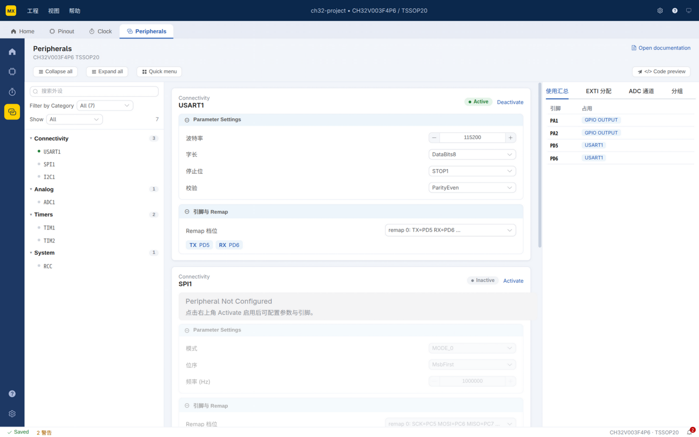

# ch32-rs-CubeMX

纯本地图形化配置器：在封装图上点引脚、配外设、调时钟树，一键导出**可直接 `cargo build` 的 [ch32-hal](https://github.com/ch32-rs/ch32-hal) Rust 工程**（WCH CH32 RISC-V 系列）。界面对标 STM32CubeMX2，代码生成后端是 Rust（不是 C）。

提供两种形态：

- **桌面应用**（Tauri 2，推荐）：下载 [Releases](https://github.com/3808000/ch32-rs-cubemx/releases) 中的 Linux 产物，解压即用。
- **浏览器模式**：`npm run dev`，或 `npm run build` 后部署 `dist/`。

| 引脚配置 | 时钟树 | 外设 |
|---|---|---|
|  |  |  |

## 下载桌面版

| 平台 | 产物 | 说明 |
|---|---|---|
| Linux x86_64 | `ch32-rs-cubemx-v0.01-linux-x86_64.tar.gz` | 解压后运行 `./ch32-rs-cubemx`（需系统 WebKitGTK 4.1，主流发行版已自带）|
| Linux x86_64 | `.rpm` / `.deb` | 包管理器安装（若本次构建产出）|
| Windows / macOS | 从源码构建 | 需在对应平台执行 `npm install && npm run desktop:build` |

## 快速开始（源码）

```bash
npm install
npm run dev          # 浏览器模式 http://localhost:5173
npm run desktop:dev  # 桌面模式（Tauri，需要 Rust 与 WebKitGTK 开发包）
```

Linux 构建桌面版需要：`webkit2gtk4.1-devel libsoup3-devel gtk3-devel librsvg2-devel`（Fedora）或
`libwebkit2gtk-4.1-dev libsoup-3.0-dev libgtk-3-dev librsvg2-dev`（Debian/Ubuntu）。

```bash
npm run desktop:build          # 产物：src-tauri/target/release/ 与 bundle/
```

## 验证命令

```bash
npm run test             # Vitest 单元测试（380 用例）
npm run build            # vue-tsc 类型检查 + vite 构建
npm run lint             # ESLint
npm run validate:device  # 器件数据校验（CI 必过）
npm run verify:build     # 端到端：生成工程 → cargo build --release
```

`verify:build` 需要 Rust nightly（rv32ec 是 tier-3 target）：

```bash
rustup toolchain install nightly --component rust-src
```

环境变量：`CH32_HAL_DIR`（本地 ch32-hal 克隆，加速验证）、`CH32_HAL_REV`（覆盖锁定 rev）。

## 已支持芯片

| 芯片 | 封装 | 内核 / Target | 代码生成 |
|---|---|---|---|
| CH32V003F4P6 | TSSOP20 | QingKe V2A · riscv32ec（nightly） | ✅ ch32-hal |
| CH32V203C8T6 | LQFP48 | QingKe V4B · riscv32imac | ✅ ch32-hal |
| CH32H417QEU6 | QFN128 | QingKe V3F + V5F 双核 · riscv32imac | ✅ ch32-hal（Cargo workspace，`cargo xtask build` 逐核构建）|
| CH582M | QFN48 | QingKe V4A · riscv32imac | ⏳ 数据可查（引脚/时钟/外设），HAL 后端为 ch58x-hal，导出被守卫阻止 |

CH582M 与 CH32 系列同属 WCH RISC-V，但 BLE 系列的 HAL 是独立的 [ch58x-hal](https://github.com/ch32-rs/ch58x-hal)（API 与 ch32-hal 不同）。当前可在工具中查看其引脚复用、时钟预设与外设通道；代码生成后端接入后即可导出。

```bash
npm run verify:build                 # 默认验证 V003 + V203
npm run verify:build -- --embassy    # 异步（embassy + DMA）场景
```

## 如何新增一颗芯片（3 步）

1. **导入只读数据**：`node scripts/import-ch32data.mjs --chip CH32V203C8T6`
   从 ch32-data 生成 `remap.json` / `interrupts.json` / `dma.json`（信号/remap 与 HAL 同源）。
2. **人工录入三份数据**（参考 `data/devices/ch32v003f4p6/`）：
   - `chip.json`：封装物理引脚编号（查数据手册）、`halFeature`（完整小写型号）、`target`、`nightly`、特殊引脚、ADC 通道。
   - `clock.json`：时钟源/PLL 参数/分频档位/上限/预设（读 `ch32-hal/src/rcc/<family>.rs` 核对）。
   - `peripherals.json`：外设实例 remap 引脚表 + 参数（枚举名逐字对应 HAL）。
   并在 `src/data/device.ts` 注册导入。
3. **校验 + 编译验证**：`npm run validate:device && npm run verify:build -- --chip CH32V203C8T6`。

不需要改任何组件或 lib 代码——芯片差异全部由数据字段表达。

## 如何烧录

导出的工程自带 `.cargo/config.toml` runner（[wlink](https://github.com/ch32-rs/wlink)）：

```bash
cargo install wlink
cd <导出工程>
cargo run --release    # 编译并经 WCH-Link 烧录，--enable-sdi-print 查看调试打印
```

## 工程结构约定

- `src/generated/**`：每次导出整体重写，**勿手动编辑**。
- `src/main.rs`：用户代码区，生成器永不覆盖。
- `cube.json`：配置回读，可拖回本工具继续编辑。

## 文档

- [AGENTS.md](AGENTS.md)：项目约定
- [docs/PROJECT_MEMORY.md](docs/PROJECT_MEMORY.md)：架构地图 + 决策记录
- [docs/HAL_API_NOTES.md](docs/HAL_API_NOTES.md)：核对过的 ch32-hal API（含锁定 rev）

## 技术栈

Vite · Vue 3 · TypeScript · Pinia · Element Plus · 原生 SVG · EJS · JSZip · Monaco · Vitest