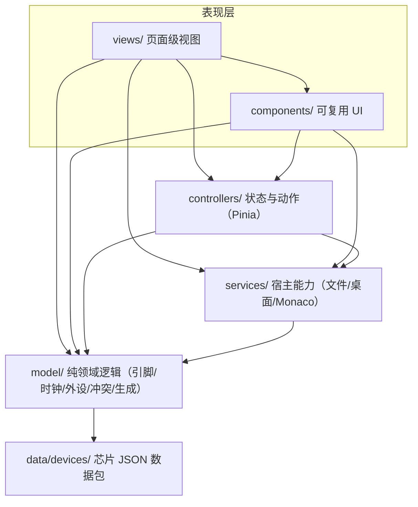

# 架构（MVC 分层）

> 适用范围：`src/**` 应用代码。本文是新增代码“放哪一层”的决策依据；违反分层会被 `npm run lint` 拦截。
> 相关文档：[AGENTS.md](../AGENTS.md)、[PROJECT_MEMORY.md](./PROJECT_MEMORY.md)、[HAL_API_NOTES.md](./HAL_API_NOTES.md)。

## 1. 目标

- **单向依赖**：上层可以调用下层，下层永不反向依赖上层。依赖只能沿 `views/components → controllers → services → model` 向下。
- **model 纯净**：领域模型不感知 Vue、Pinia、DOM、浏览器/桌面宿主能力，可被 Node/Vitest 直接测试。
- **单一状态源**：跨视图共享状态只有 `src/controllers/project.ts` 一个 Pinia store；视图不各自持有业务状态。
- **数据驱动**：芯片差异全部在 `data/devices/**`，代码里不写 `if (chip === '...')`。

## 2. 分层图



文字版（箭头 = “允许依赖”）：

```
views / components ──┬──→ controllers ──→ services ──→ model ──→ data/devices
                     ├──→ services
                     └──→ model            （跨层直连只允许向下）
```

被禁止的方向（ESLint 强制）：

```
model ✗→ controllers / services / views / components
services ✗→ controllers / views / components
controllers ✗→ views / components
```

## 3. 各层职责

| 层 | 路径 | 职责 | 允许依赖 | 禁止依赖 | 典型内容 |
|---|---|---|---|---|---|
| 视图层 | `src/views/` | 页面级编排：页头、工具栏、布局、组合各面板 | 全部下层 + `components` | — | HomeView、PinoutView、ClockView、PeripheralsView |
| 组件层 | `src/components/` | 可复用展示与局部交互（封装图、表格、面板、对话框、通用控件） | 全部下层 | — | `common/` 为无领域依赖的原子组件；其余为业务面板 |
| 控制层 | `src/controllers/` | 应用状态与动作：唯一 Pinia store、配置组装、冲突 getter、脏标记、持久化动作 | `model`、`services`、同层 | `views`、`components` | `project.ts`（`useProjectStore`） |
| 服务层 | `src/services/` | 宿主/平台能力：工程文件解析与下载、Tauri 桌面桥、Monaco 加载、Node 内建模块 stub；导出编排与持久化 | `model`、同层、第三方库 | `controllers`、`views`、`components` | `projectFile.ts`、`projectStorage.ts`、`projectExport.ts`、`desktop.ts`、`monaco.ts`、`nodeStub.ts` |
| 模型层 | `src/model/` | 纯领域逻辑与 schema：引脚分配/占用/分组、时钟计算与树布局、外设归并、冲突规则、代码生成、封装几何 | 同层、`model/types`（`@/model/types` 统一出口） | `controllers`、`services`、`views`、`components` | `device.ts`、`package.ts`、`pins/`、`peripherals/`、`clock/`、`conflicts/`、`codegen/`、`types/` |
| 数据层 | `data/devices/<chip>/` | 芯片数据包（chip/remap/exti/clock/peripherals/interrupts/dma JSON），由 `model/device.ts` 注册与查询 | —（只被 model 读取） | 任何代码依赖 | 新增芯片只改这里 + 数据校验脚本 |
| 测试 | `tests/` | 以 model 为主的单元/快照测试 | 任意层 | — | `tests/*.test.ts` |

## 4. 依赖方向规则

### 4.1 基本规则

1. **只允许向下**：依赖方向固定为 `views/components → controllers → services → model`。下层不得 import 上层任何文件。
2. **同层可互引**：`model/` 内模块互相引用（如 `conflicts` 用 `clock`）是允许的；`services/projectFile.ts` 用 `services/desktop.ts` 也允许。
3. **跨层可越级，但只能向下**：视图可直接用 `model` 的纯函数、`services` 的文件能力，不必每件事都经过 controller；但 `model` 永远不能回头拿 store 或 UI。
4. **统一别名**：跨层 import 使用 `@/model/...`、`@/controllers/...`。ESLint 按解析后的目录判断依赖层级，覆盖别名、相对路径、重导出和字面量动态导入。
5. **类型导入同样受限**：即使 `import type { X } from '@/controllers/...'` 也会被拦截，避免类型层面的隐性耦合。

### 4.2 状态访问 = 参数注入

model 层通过函数参数接收配置，返回计算结果或操作建议。控制层负责更新工程状态。组件从控制层读取结果并处理对话框、提示等交互。

引脚覆盖沿用 `usePinOverwrite`。组件收到确认后调用工程 store 的 `applyPinOverwrite`，由 store 记录修改前的引脚快照。工程加载、切换芯片和重置引脚会清空该工程的引脚覆盖历史。全局撤回通过同一套配置加载动作清理覆盖历史。

### 4.3 ESLint 强制

`eslint.config.js` 的 `app/layer-boundary` 按文件路径识别层级，检查普通导入、类型导入、重导出和字面量动态导入。模型层禁止依赖 Vue、Pinia、Element Plus 和 Tauri。新增层时在 `forbiddenLayers` 中更新依赖边界。

### 4.4 时钟模型

`src/model/clock/index.ts` 保留统一调用入口。配置默认值、锁定与预设在 `config.ts`，频率计算在 `frequency.ts`，物理与 HAL 限制在 `validation.ts`，目标频率求解及自动修复在 `solver.ts`。`tree/` 分别处理控件写回、图的构建和画布布局。图形模型和 HAL 导出复用同一套数据与规则，生效的 HAL 后端由 `src/model/halBackend.ts` 统一解析。

## 5. 新代码放哪：决策表

| 你要做的事 | 放到哪 | 说明 |
|---|---|---|
| 新增芯片 / 封装 / 时钟预设 / 外设 remap 数据 | `data/devices/<chip>/*.json` + 在 `src/model/device.ts` 注册 | 只改数据，禁止在组件里写芯片分支 |
| 新增纯算法、校验、规则（引脚、时钟、冲突） | `src/model/<domain>/` | 不 import Vue/Pinia/DOM；可直接 Vitest |
| 新增冲突检查规则 | `src/model/conflicts/index.ts` | 输入 `ProjectConfig + DeviceData`，输出 `Conflict[]` |
| 新增外设参数/占用归并逻辑 | `src/model/peripherals/index.ts` | 数据驱动，参数 spec 来自 JSON |
| 新增代码生成产物 / 模板 | `src/model/codegen/` | 纯字符串生成；不得触达文件系统（写盘由 services 负责） |
| 新增/修改领域类型、ProjectConfig schema | `src/model/types/`（按领域拆分，`index.ts` 统一导出） | 全层共享的唯一类型源；对外始终 `import ... from '@/model/types'` |
| 新增浏览器/桌面能力（文件、下载、Tauri、Monaco） | `src/services/` | 只做宿主适配，不持有业务状态、不 import 视图 |
| 新增跨视图共享的状态或动作（选中项、脏标记、保存） | `src/controllers/project.ts` | 单一 store；getter 组装 config/conflicts，action 负责改状态 + `markDirty()` |
| 新增需要确认/撤回的破坏性操作 | 复用 `src/components/pinout/usePinOverwrite.ts` | 调用 `requestOverwrite` 发起确认，由工程 store 执行覆盖并维护撤回记录 |
| 新增页面（Tab/视图） | `src/views/` + 在 `App.vue`/`TabStrip`/`IconRail` 注册 | 页面级布局；业务面板拆到 components |
| 新增可复用面板/对话框/控件 | `src/components/` | 无领域依赖的原子控件放 `src/components/common/` |
| 新增组合式逻辑（需要 store + 生命周期） | 优先放 `src/controllers/`；确属展示逻辑可留在组件内 | 不要把 store 访问塞进 model |
| 新增单元测试 | `tests/<module>.test.ts` | 以 model 纯函数为主；快照放 `tests/__snapshots__/` |
| 新增开发/数据脚本 | `scripts/*.mjs` | 复用同源逻辑（vite-node / ssrLoadModule），禁止复制两份生成逻辑 |
| 架构约定变更 | 本文 + `AGENTS.md` | 同步更新 ESLint 规则 |

快速判断：

- 不含 import 的“纯计算”？→ `model`。
- 需要 `window`/`localStorage`/`fetch`/Tauri/第三方 SDK？→ `services`。
- 需要“记住用户当前配置”？→ `controllers`（store）。
- 只是画出来、绑事件？→ `components`；整页拼装 → `views`。

## 6. 与 CubeMX 概念映射

| 本项目 | STM32CubeMX 对应 | 说明 |
|---|---|---|
| `model/` | **数据手册 / 参考手册的抽象** | 引脚复用与 remap、时钟树约束、外设通道、冲突规则、封装几何——都是“芯片事实 + 规则”，与界面无关。对应 CubeMX 的 MCU 数据库与校验引擎。 |
| `controllers/project.ts` | **`.ioc` 的内存状态 + 工程模型** | `assignments/groups/clock/peripherals/features/unlocked/selectedPin/dirty` 就是一次工程会话；`config` getter 等价于把 `.ioc` 序列化成 `ProjectConfig`。 |
| `services/` | **CubeMX 的宿主编排层** | 工程文件导入导出（`cube.json` ↔ `.ioc`）、另存为、Monaco 预览、桌面文件写入；不放芯片规则。 |
| `views/` | **CubeMX2 主视图** | Pinout / Clock / Peripherals / Home 四个一级视图，负责页头、布局、面板组合。 |
| `components/` | **CubeMX 的面板与对话框** | 封装图、引脚表、配置面板、时钟画布、外设卡片、导出对话框、通用控件。 |
| `data/devices/**` | **CubeMX 器件数据库（DB）** | 每颗芯片的引脚/复用/时钟/外设/中断/DMA JSON；新增芯片不改组件。 |
| `model/codegen/` | **CubeMX 代码生成器** | 生成 Rust + ch32-hal 工程：`generated/**` 每次重写、`main.rs` 永不覆盖。 |
| `cube.json`（导出工程内） | `.ioc` | 可回读继续编辑的配置快照。 |
| 导出工程的 `src/generated/**` | CubeMX2 `generated/` | 生成区与用户区物理隔离。 |
| 导出工程的 `src/main.rs` | 用户代码区（CubeMX1 USER CODE 段） | 生成器不覆盖；Rust 用文件隔离替代 `USER CODE BEGIN/END`。 |

一句话：**model 回答“芯片允许什么”，controllers 记住“用户选了什么”，views/components 把“用户选了什么”画出来并允许修改。**

## 7. 常见违规与修法

| 反模式 | 问题 | 修法 |
|---|---|---|
| `model/` 里 `import { useProjectStore } from '@/controllers/project'` | 反向依赖，领域逻辑无法独立测试 | 定义 deps 接口，调用方传 store（见 4.2） |
| `model/` 里 `import { isDesktopApp } from '@/services/desktop'` | 领域层感知宿主环境 | 把分支上移到 controller/service，model 只接收布尔/回调 |
| `services/` 里 import 组件或 store | 服务层绑定 UI/状态 | 输出纯数据，由 controller/组件决定展示 |
| `controllers/` 里 `import X from '@/components/X.vue'` | 控制层耦合视图 | store 只暴露状态与 action，视图自行渲染 |
| 组件里手写芯片差异 `if (chip === 'CH32V003F4P6')` | 破坏数据驱动 | 把差异写进 `data/devices/**`，用字段表达 |
| 视图各自 `ref()` 一份配置 | 多状态源、难同步 | 统一读 `useProjectStore()` |
| 覆盖引脚不弹确认、不入撤回栈 | 用户误操作不可恢复 | 一律走 `usePinOverwrite`，撤回记录随工程更新 |

## 8. 门禁与检查清单

提交前必须全绿：

```bash
npx vue-tsc --noEmit   # 类型
npx vitest run         # 单元测试
npx eslint .           # 含分层边界规则，0 error
```

改动涉及新模块时自查：

1. 新文件是否落在正确的层（§5）？
2. import 是否只指向同层或下层（§4）？
3. model 是否零 Vue/Pinia/DOM 依赖？需要状态时是否用参数注入？
4. 新增芯片差异是否只进了 `data/devices/**`？
5. 破坏性覆盖是否走 `usePinOverwrite`？
6. 是否同步更新本文或 `AGENTS.md` 的约定？
